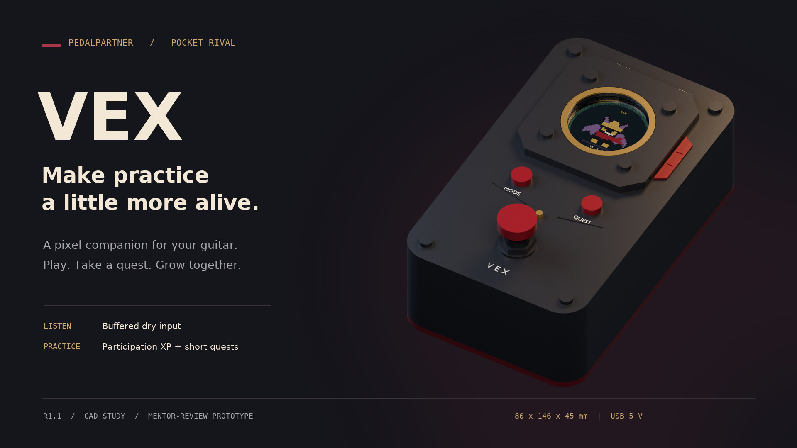
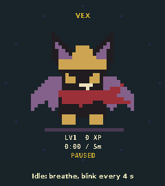

# PedalPartner

**VEX / Pocket Rival** is a first-build guitar practice companion: a pixel bat that earns participation XP while you play, with short practice quests and an experimental tuner. It listens to a buffered dry branch of your rig. Your existing guitar audio path stays independent.



[Share image](assets/marketing/vex-social.jpg) · [Render provenance and reproduction](docs/MARKETING.md). Real CAD geometry with proposed finishes; no generative imagery.



The R1.1 design keeps the crimson, charcoal and muted-gold rival-device feel through a clipped bezel, a thin gold insert, a small crimson cheek and original pixel art. The enclosure is **86 × 146 × 45 mm**, with a real **32.4 mm active display** behind a flat protective window. The concept images are inspiration; the CAD is the physical proposal.

## Start here

| Goal | Open |
|---|---|
| Prepare a lean mentor ZIP | [Pack contents and navigation](docs/MENTOR_PACK.md) — `make pack-mentor` |
| Buy the parts | [Final shopping list](docs/SHOPPING.md), [BOM CSV](hardware/data/BOM.csv) |
| Build with a mentor | [Illustrated guide](docs/VEX_Pocket_Rival_Mentor_Guide.pdf), [editable guide](docs/BUILD_GUIDE.md) |
| Review or modify the design | [CAD review map](docs/CAD_REVIEW.md), [grouped STEP](hardware/generated/VEX_Pocket_Rival_Assembly.step) |
| Print or cut parts | [Fabrication instructions](docs/PRINTING.md), [STLs](hardware/generated/stl), [DXFs](hardware/generated/drawings), [1:1 templates](docs/VEX_Pocket_Rival_1to1_Templates.pdf) |
| Try the software without hardware | [Local development](docs/LOCAL_DEVELOPMENT.md) |
| Draw VEX: sprites, colours, fonts, motion | [Art pipeline](docs/ART.md) — PNG + JSON in `art/` with per-animation play sequences, no C++; [motion video](assets/motion/vex-motion.mp4) from the shared renderer |
| Debug on a real Teensy | [Bench loop](docs/LOCAL_DEVELOPMENT.md#4-bench-loop-with-a-teensy-attached) — `make upload`, `make monitor`, `make sim DEVICE=auto` |
| Plan future coaching / hardware revisions | [Extensibility proposal](docs/EXTENSIBILITY.md) |
| Continue with another agent | [AGENTS.md](AGENTS.md), [current handoff](docs/HANDOFF.md), [next milestones](docs/PLAN.md) |

## Try it locally

Requires Python 3.10+, Make and a C++17 compiler. On macOS, install the Xcode command-line tools first.

```sh
git clone https://github.com/ash0ts/PedalPartner.git
cd PedalPartner
make test
make sim
```

`make sim` also needs Emscripten (`brew install emscripten`). Open **http://127.0.0.1:8765**: the firmware's shared state machine, analyzer and renderer run in the browser as WebAssembly. Hold QUEST to calibrate, tap the footswitch, advance five active minutes, then try silence, clipping, stale samples, the tuner with a synth note or your Mac input, saving, a power cut and rebooting. It does not emulate the Teensy's codec, timing or electronics.

With Arduino CLI installed, `make setup-firmware` installs pinned dependencies and `make firmware-all` compiles all four bring-up stages **without uploading**. See the [full instructions](docs/LOCAL_DEVELOPMENT.md).

## Bench loop

When a Teensy is on the bench, the same workbench mirrors it. Nothing below runs during `make test` or `make firmware-all`; only `make upload` programs a board.

```sh
make firmware STAGE=4 && make upload STAGE=4      # explicit port: SERIAL=/dev/cu.usbmodemXXXX
make monitor                                      # one JSON line per second: flush_us, tx_bytes, yin_us, cpu, anim
make sim DEVICE=auto                              # Device tab: real panel beside the WebAssembly one
```

The sketch prints what it measures (`flush_us`, `flush_max_us`, `loop_max_us`, `tx_bytes`), accepts single-character switches over serial (`f` full flush, `b` band diff, `1`/`2` cadence, `l` link, `m q k` / `M Q K` tap or hold the controls) and, with the link on, streams the changed rows so the **Device** tab shows the real GC9A01A next to the browser frame with a live pixel-diff count and sparklines. The protocol is `firmware/VEX_Pocket_Rival/link.h`; the bridge is `tools/web.py serve --device`. Details in [Local development](docs/LOCAL_DEVELOPMENT.md#4-bench-loop-with-a-teensy-attached); what the bench has and has not yet proven is in the [handoff](docs/HANDOFF.md).

## Current status

- Desktop core and simulator tests pass locally.
- CAD: 72 named physical components, five service groups, 2,556 pairwise overlap checks with no modeled solid overlaps. STEP re-import preserves names, groups, per-part bounds, volumes and solid counts.
- Automatic CI runs only a short Linux desktop test job. Firmware and CAD builds are manual under [Actions](https://github.com/ash0ts/PedalPartner/actions). All four stages compile locally with the pinned Teensy core; nothing has run on a board yet, so SPI timing, tearing and perceived motion are still bench questions the Device tab is built to answer.
- This is a **mentor-review prototype**, not a physically validated pedal. Purchased parts, solder/header heights, cable fit, power/noise, display readability and foot-load behavior still need bench tests. [Evidence and limits](docs/HANDOFF.md).

R1.1 uses Teensy 4.1, Audio Adapter D/D2, Adafruit 6178 and USB 5 V. It has no audio output, bypass, muting or 9 V pedal-power input. No technique scoring or calendar streaks are claimed.

Original project work uses the existing [MIT license](LICENSE). Imported CAD and fonts retain their own terms; see [third-party notices](docs/THIRD_PARTY.md).
