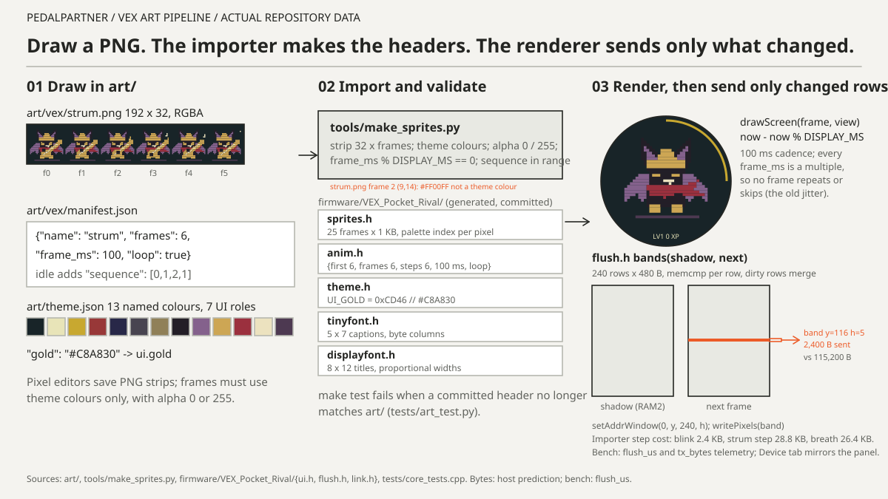
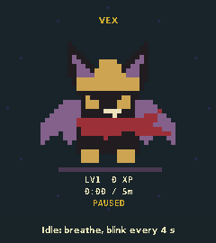

# Art pipeline — sprites, theme, fonts and motion

VEX's character, colours and fonts are data in `art/`. An artist edits PNG and JSON files in any
pixel editor; `tools/make_sprites.py` validates them and writes the C++ headers the firmware, the
native simulator and the browser workbench all compile. Nobody has to touch `ui.h` to change how
VEX looks or moves.



The figure's editable source is `docs/figures/art-pipeline/` (spec + three state SVGs). Byte
counts in it are the importer's step-cost prediction from the host; `flush_us` on the bench is the
measurement, and the Device tab shows the real panel beside the simulator's frame.

## Files

| Path | What it is | Contract |
|---|---|---|
| `art/theme.json` | Named colours (`#RRGGBB`) and the seven UI roles (`bg, ink, gold, red, dim, plum, fade`) | Max 16 colours, all distinct in RGB. Role names map to `UI_*` in `theme.h`; colour names to `COLOR_*`. |
| `art/vex/manifest.json` | Ordered animations: `{"name", "frames", "frame_ms", "loop", "sequence"?}` | Order is the firmware enum (`ANIM_IDLE`, …). `frames` 1–16 drawn cells; `frame_ms` a multiple of `DISPLAY_MS` (100); `loop:false` plays once from its trigger. Optional `sequence` is the play order over the drawn frames, 1–32 steps, e.g. `[0,1,2,1]` for a ping-pong breath; without it the frames play in order. |
| `art/vex/<name>.png` | One strip per animation: `32 × frames` wide, 32 high, RGBA | Every opaque pixel must be exactly a theme colour; alpha is 0 (transparent) or 255. Up to 15 sprite colours in total. |
| `art/fonts/tiny.png` | 95 glyphs, 5 × 7 at a 6 px pitch, characters 32–126 | White = ink. Used for captions. Rasterised from the bundled DejaVu Sans Mono. |
| `art/fonts/display.png` | 95 glyphs in 8 × 12 cells, 8 px pitch | White = ink. The importer trims each glyph and emits a width table, so the font is proportional. Used for titles, note names and banners. Rasterised from the bundled DejaVu Sans Bold at 9 px. |

Generated into `firmware/VEX_Pocket_Rival/` and committed: `theme.h`, `sprites.h` (palette +
one byte per pixel, 1 KB per frame), `anim.h` (per animation: first frame, drawn count, first step,
step count, period, loop; plus the flat `VEX_ANIM_STEPS` play-order table), `tinyfont.h`,
`displayfont.h`. `assets/vex_sheet.png` is a contact sheet of every drawn frame.

## The current set

| Animation | Drawn | Steps | Period | What moves |
|---|---|---|---|---|
| `idle` | 3 | `[0,1,2,1]` | 500 ms | Breath over the wings and collar only (rows 14–24; feet and head planted), then a one-column ear twitch on the third frame |
| `blink` | 3 | 0 1 2 | 100 ms | Eyes close over three frames, one-shot every 4 s |
| `strum` | 6 | 0–5 | 100 ms | Anticipation, down, contact, release, follow-through, rest. The hand and neck move in rows 20–26; notes are born gold near the strings, drift up as cream, then wink out |
| `cheer` | 4 | 0–3 | 200 ms | Squash (head and wings settle one row, one torso row removed), hop 1 px with sparkles, hop 2 px at the peak with more sparkles and a narrower shadow, land with fading cream dots |
| `levelup` | 4 | 0–3 | 200 ms | Crown glint sweeps left to right; two opposite sparkles rotate around the bat |
| `listen` | 2 | 0 1 | 500 ms | The tall ear tilts one column and the sound arcs step up |
| `sleep` | 3 | 0–2 | 500 ms | A small z appears low, grows into the big Z, which fades to shadow while the next z appears |

### What a step costs the pedal

`python3 tools/make_sprites.py` prints, for every animation, the screen rows the dirty-band flush
will send for each step (sprite rows that differ × 5, since the pet is drawn at 5×) and the bytes
that means over SPI. Current values at the 100 ms cadence:

```
idle     4 steps, worst  55 rows /  26400 B   0>1:55 1>2:20 2>1:20 1>0:55
blink    2 steps, worst   5 rows /   2400 B
strum    6 steps, worst  60 rows /  28800 B   0>1:15 1>2:40 2>3:55 3>4:60 4>5:35 5>0:5
cheer    4 steps, worst 150 rows /  72000 B   (3 s celebration at 200 ms; whole bat hops)
levelup  4 steps, worst  65 rows /  31200 B
listen   2 steps, worst  40 rows /  19200 B
sleep    3 steps, worst  60 rows /  28800 B
```

**Planted-rows budget**: anything that plays for minutes (idle, strum, listen, sleep) should keep
every step at or under about 30 % of the panel (72 rows). `tests/core_tests.cpp` enforces that for
idle by rendering consecutive steps and counting bands. Celebrations may move the whole bat; they
last three seconds. A full frame is 240 rows / 115200 B; the bench measures what that takes
(`flush_us` in the telemetry, see [LOCAL_DEVELOPMENT.md](LOCAL_DEVELOPMENT.md#4-bench-loop-with-a-teensy-attached)).

## Workflow

```sh
python3 tools/make_sprites.py            # import art/ → headers (standard library only)
make art-check                           # verify committed headers match art/ without writing
make sim                                 # workbench; saving a PNG re-imports, rebuilds and reloads
python3 tests/simulator_test.py --update-golden   # after an intentional look change; review frames
python3 tools/render_gallery.py          # every screen state into assets/screens/
make motion                              # verify motion segment by segment and re-encode assets/motion/
```

`make test` runs `tests/art_test.py`, which fails when a committed header is stale and checks that
the importer rejects off-palette pixels, partial alpha, wrong strip sizes, bad timing, bad
sequences (an index past the drawn frames, an empty list, more than 32 steps) and missing roles,
and that a sequence reaches `anim.h` with a matching step-cost report. The error names the file,
frame and pixel, for example
`art error: strum.png frame 2 pixel (9,14): #FF00FF is not a theme colour`.

Goldens in `tests/golden/` are pixel-exact frames rendered by the native simulator. Any visible
change makes them fail on purpose; regenerate, look at the contact sheet, commit the new frames.
The WebAssembly build is compared against the same goldens, so the browser cannot drift from the
device renderer.

If the pet card frame used for the CAD texture changes (`tools/render_screen.py`), the hero
render's provenance goes stale and `make hero` must run (see [MARKETING.md](MARKETING.md)).

## See it move



`make motion` (needs ffmpeg) drives the native simulator through the storyboard in
`tools/render_motion.py`, captures one frame per `DISPLAY_MS`, checks that each segment shows only
its animation and that every loop advances exactly one step per `frame_ms` (never skipping or
reversing a step, and advancing at least once in a segment longer than a step), then writes
[`assets/motion/vex-motion.mp4`](../assets/motion/vex-motion.mp4) (480 × 540, 10 fps, 18 s), the GIF
above, [`storyboard.png`](../assets/motion/storyboard.png) (one frame per segment) and
`storyboard.json` (segment times and the animations seen). Captions are drawn with the firmware's
own display font. Re-run it after any art or motion change so the video matches the headers. The
pixels are the device's; the timing is the simulator's clock, not a measured panel.

## How motion works

- `config.h` sets `DISPLAY_MS=100`. `drawScreen` quantises `View::now` to that cadence before
  anything is drawn, so the device, the native simulator and the browser pick the same frame for
  the same millisecond. Every `frame_ms` is a multiple of it; the importer refuses others. This is
  what removed the strum jitter: a 250 ms toggle sampled every 200 ms repeated and skipped frames.
- `ui.h::chooseAnim` picks an animation by state priority: level-up > fragment cheer > tuner
  listen > strum while sound is credited > sleep after 30 idle seconds > blink (one-shot every 4 s)
  > idle breathe. Loops index step `(now / frame_ms) % steps`; one-shots run from their trigger.
  `spriteIndex` maps the step through `VEX_ANIM_STEPS` to a drawn frame, so a `sequence` costs
  nothing at run time. The step index is what the simulator JSON, the scenarios (`expect frame=`)
  and the bench telemetry report.
- The quest ring is a continuous 4 px arc; its leading square eases gold → fade → ink → fade in
  250 ms steps while time is being earned (theme colours only, one 4 × 4 band per step). Unfilled
  fifths keep a dim tick.
- On the Teensy, `flush.h` compares the new frame with a shadow copy of what the panel shows
  (`DMAMEM`, RAM2) and sends only the changed rows as up to eight bands. The step-cost table above
  is the host's prediction of those bands; the sketch's `tx_bytes` and `flush_us` telemetry is the
  measurement. If the bench cannot keep up, press `2` on the serial link to try a 200 ms cadence
  before changing `DISPLAY_MS`.

## Drawing guidance

- The panel is 32.4 mm across; a 32 × 32 sprite is drawn at 5× (160 px). One sprite pixel is about
  0.68 mm. Silhouette and two-tone contrast read; single-pixel detail does not.
- Keep feet and floor (rows 26–31) planted in idle, blink, strum, listen and sleep so the character
  does not slide and the flush stays small. A breath moves wings and collar, not the head; 1 px is
  a settle, 2 px is a hop (cheer only).
- Prefer a `sequence` over duplicate frames: `[0,1,2,1]` gives a four-step breath from three drawn
  cells and keeps `sprites.h` 1 KB smaller per avoided frame.
- Secondary motion sells it: a note that drifts and fades, a sparkle that rotates, a Z that grows.
  Two colours per element (gold then cream, cream then shadow) read as motion at 5×.
- New colours go in `theme.json` first. The sprite palette has room for 15; the display is RGB565,
  so pick values whose low bits are zero (`#C8A830` round-trips exactly, `#C9A931` does not) if
  you need the hex in the theme and the hex on screen to match.
- Preview at true size: the workbench has a 32.4 mm toggle. If a frame reads at that size on a
  laptop screen, it reads on the pedal.
- Timing: 100 ms per step for an action, 200 ms for a bounce, 500 ms for breathing, listening or
  sleep. Anything under 100 ms cannot be shown. Run `python3 tools/make_sprites.py` and read the
  step-cost table before committing; `make motion` then proves the loop advances cleanly.

## Contributing art

Original work only. By contributing files under `art/` you license them under the repository
licence; include a line in your pull request naming the author. Bundled fonts are DejaVu
(`assets/fonts/LICENSE.txt`). Do not trace copyrighted characters or ship art generated from
another project's sprites. Keep VEX a bat with charcoal, crimson and muted gold.
